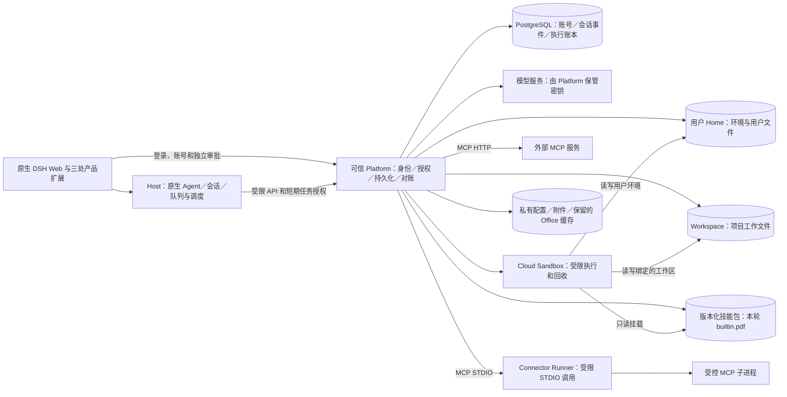

# PowerEvolve 云端迁移开发方案

2026-10-10；用户已确认启动迁移，并授权代理自行作出后续技术决策。当前交付范围以本节的最新用户调整为准，原清单保留为后续迁移台账。

## 当前交付范围

2026-10-12 用户确认以本轮迁移验收和交付收口：同版本真实业务验收、必要回归及独立审查、固定镜像及部署／数据迁移／恢复回退资料全部通过后，完成本轮迁移验收。逐文件四项100%覆盖率不足登记为后续质量事项，不再阻塞本轮交付；原文件集合、阈值、检查入口及失败结果保留，不将覆盖失败写为检查通过。功能缺失、必测用例漏跑、账号或挂载隔离问题、数据丢失、恢复失败及未决副作用重放仍阻塞交付。核心试用继续使用固定镜像和独立数据库，后续开发在独立环境推进，经验证后再切换版本。

2026-10-13 用户明确当前没有正式旧用户数据。本轮交付新 Schema 6 系统，不执行生产 Schema 37 全库转换；保留兼容代码、人工样本和原失败。最终镜像的样本维护检查为只读捕获、未签名 cut 拒绝通过，九类 owner 迁移在写入前超过原阶段期限，登记为后续兼容事项，不改原预算或将完整产物集合写为全通过。当前试用数据及 Schema 6 完整备份恢复结果继续保留；直接影响试用和新系统的故障仍须关闭。

2026-10-13 按用户要求复核剩余工作的必要性，利用其已授权的技术决策权调整收口顺序：公开 CI 每次重建旧 Schema 37 服务、Kind 和样本的自动化全链路验证留作具名工程欠账，不再阻塞本机迁移交付。CI 配置与失败记录保留，不能称其完整通过。此前要求最终镜像的 maintenance 三项按上述最新旧数据事实处理；原样本和检查结果保留，不重新生成旧业务。其余已通过且未受改动影响的业务不重复验收，最终镜像／代码关联、部署恢复资料及独立审查继续完成。

当前工作先正常结束已启动的检查并保存修改与证据，随后集中完成新完整镜像的2＋2组合、跨副本读回及恢复、新任务、最终同版本回归和交付审查。完成后的局部故障修复按实际变更验证：保留未受影响且源码／依赖／配置等值的验收记录，重验受影响的源码、正式产物及用户流程；不因为局部修复重复全部已通过场景。试用发现的问题按影响处理，修复须同步进入交付代码并验证受影响行为；较重的覆盖补测安排在用户空闲时段。此安排不扩大功能范围，也不要求每个小修复重跑全部已通过检查。

2026-10-10 用户要求优先完成主体框架及核心功能：SSH／MCP 插件本轮只交付 MCP，内置技能本轮只交付 `builtin.pdf`。SSH、其他八项内置技能及其专用报告、Word／Excel／PowerPoint 业务验收延后。PDF 实际需要的运行时依赖仍属于本轮；不能据这些依赖的存在宣称其他技能已完成。

本轮继续完成账户与权限、原生会话与队列交互、持久事件与流恢复、Host／Platform 多副本、云端执行、用户 Home／Workspace／附件存储、MCP、PDF、当前范围所需旧数据适配、部署及备份恢复。跨重启未决请求对账、真实用户流程、同版本质量门禁和独立审查仍是完成条件。旧代码、用户数据、完整数据库备份及已有证据保留；延期项不计作本轮通过，也不再为其新增专用开发和完整验收矩阵。

下文原18项清单描述原完整迁移目标；执行顺序和本轮验收须应用上述范围调整。范围外的五项旧功能及产品 Device／Electron 排除决定不变。具体分工与实际证据由[集成进度](TRIAL-CLOUD-MIGRATION-STATUS.md)拥有。部署、备份恢复及回退操作参照[Schema 6 操作说明](deploy/CLOUD-OPERATIONS.zh.md)。

## 摘要

从固定的官方 DSH `dsh-v0.2.1-alpha.1` 基线建立干净迁移分支，以 `power-evolve/native-cloud-client` 的云端实现、测试和未提交修复为来源，按本轮确认范围迁入 Platform、Host 适配、存储、执行、连接器和部署能力。最终系统必须能够独立部署、登录使用、保存数据、重启恢复，并具有下一次 DSH 升级可复用的验证流程。

界面改动限定为官方插件页中的 MCP／SSH 接入、现有 Skills 页和左下角账号菜单。原生设置、对话、输入框、消息、右侧资源预览及其他布局保持目标 DSH 的行为和样式。用户已确认不迁入[原生 DSH 没有的五项旧功能](#本次不迁入的旧功能)，完整云端交付以调整后的功能清单为准。产品 Device、Electron、本机执行、配对和执行位置选择器均不迁入；官方基线自带的桌面源码不作为产品迁移项。

长期维护范围是产品插件、可信 Platform、Host 云端适配、运行镜像与部署工具，以及有回归测试和移除条件的必要 DSH 补丁。工程约束查阅[工程复盘](CLOUD-ENGINEERING-REVIEW.md)；来源、确切版本及已知缺口查阅[迁移来源核查记录](TRIAL-CLOUD-MIGRATION-BASELINE.md)。已有[架构决策](reference/ARCHITECTURE.md)和[纵切面计划](reference/DELIVERY-PLAN.md)中涉及桌面的安排不适用于本次云端迁移。

## 目录

- [基线与分支](#基线与分支)
- [系统职责与迁移位置](#系统职责与迁移位置)
- [功能迁移清单](#功能迁移清单)
- [原生界面与接口适配](#原生界面与接口适配)
- [共享接口与数据兼容](#共享接口与数据兼容)
- [工程规范与质量检查](#工程规范与质量检查)
- [开发阶段与分工](#开发阶段与分工)
- [测试与完成标准](#测试与完成标准)
- [部署交付与回退](#部署交付与回退)
- [后续 DSH 升级流程](#后续-dsh-升级流程)
- [方案确认事项](#方案确认事项)

## 基线与分支

本次采用从官方基线逐项迁入的方式。迁移过程中固定一个官方提交，不追随不断变化的 `master`。开工前核验发布标签与核查记录中的提交一致；遇到必须处理的上游修复，以独立补丁或明确的新基线变更登记。

| 分支或版本 | 用途 | 操作约束 |
| --- | --- | --- |
| 官方／fork 的 `master` | 跟随上游并提供升级候选 | 不混入产品改动；与另一个 PowerEvolve 仓库的 `main` 区分 |
| `power-evolve/native-cloud-client` | 本轮功能、源码、测试与修复来源 | 保留历史和固定试用；逐项迁入，不整体合并旧分支 |
| `power-evolve/migrate-dsh-0.2.1-alpha.1` | 已建立的迁移集成分支 | 从固定官方标签建立；名称在开工时登记 |
| 员工任务分支 | 开发一个可验收的迁移切片 | 从迁移集成分支建立；独立工作树；小批次集成 |
| 新产品版本 | 本轮验收通过后的产品基线 | 固定标签、镜像摘要和运行配置；下一轮升级从此版本开始 |

开工前把已验证的未提交修复保存为可审查的独立提交或补丁，同时保留原始差异与测试证据。当前修复包含扩展中心浏览器依赖闭包、禁用状态处理及产物测试入口；源码存在不等于这些修复已经全系统验收。

迁移完成后，以新分支的实际文件树建立产品集成基线，归档旧来源。不得把旧分支再次整体合入、带回已排除的 Device 或界面改动。是否沿用旧产品分支名由最终切换方案决定，切换须保留旧标签与匹配的数据检查点。

## 系统职责与迁移位置

保留共享 DSH Host 和独立可信 Platform，使用两个独立 `dsh` Profile。职责划分沿用[产品架构](reference/ARCHITECTURE.md#service-ownership)，具体模块实现查阅各模块 README。

同一用户的会话共享 Home 环境，Workspace 按项目绑定；同一项目的会话使用对应工作区，不同项目使用各自工作区。原生执行按调用、终端或独立 STDIO 动作分配执行 Pod；同一用户不同项目、同项目不同会话可以并行，数量由部署配额控制。Session 事件日志保留单写者；原生文件编辑只协调实际同一路径，Shell 与 MCP 按程序自身文件语义运行。审批、账户与存储／权限代际、租约和精确 UID 停止证明仍逐次核验；不确定外部作用只对账，不重放。沙盒回收不删除持久 Home、Workspace 或技能包。SSH 新功能及其他八项内置技能延期，已有数据保留；图中仅标本轮交付的 MCP 和 PDF。

| 迁移单元 | 来源入口 | 迁入要求 |
| --- | --- | --- |
| Platform | [application/src/platform](application/src/platform/index.ts)、[Platform Profile](platform/README.md) | 按功能清单迁入身份、逐资源授权、PG、用户配置、模型与凭据、受理与租约、工作区、原生文件／资源适配、技能、预览、连接器、执行与系统恢复；不迁五项排除功能的专用实现 |
| Host | [application/src/host](application/src/host/index.ts)、[Host Profile](host/README.md) | 继续组合原生 Agent、Session、Inbox；接入持久化、调度、模型和工具；补齐新版原生 RPC／事件适配 |
| 协议与共享类型 | [contracts](contracts/README.md)、[application contracts](application/src/contracts.ts) | 拆出 Cloud 所需的请求与状态；保持浏览器纯协议依赖与 Node 执行依赖分离 |
| 客户端 | [cloud-web](cloud-web/README.md)、现有 `client-*` | 按目标 DSH 的官方 Web 组成装配，迁入三处允许的扩展；文件与预览使用原生接口 |
| 云执行与预览 | [Sandbox](sandbox/README.md)、[Office 预览](application/src/platform/office-previews.ts) | 保留真实执行身份、受限挂载、取消、停止证明、回收与故障对账；云执行、连接器、Office 解析按各自授权运行 |
| 连接器 | [Connector Runner](connector-runner/README.md)及 Platform MCP／SSH／STDIO 模块 | 配置、凭据、发现、审批、调用、结果、原会话续接与清理形成完整链路 |
| 数据与运维 | [部署](deploy/README.md)、[备份工具](deploy/backup.mjs) | PG 兼容、持久文件根、私有配置、镜像、权限、健康检查、备份恢复和精确启停一起交付 |

Platform 独占数据库、模型密钥、基础设施权限和存储根；Host 只得到受限 API 与当前任务授权。普通对话和读取技能说明不创建执行沙盒。云端 Profile 显式选择插件，不继承不受限的本地执行 Profile。

云端代码的依赖检查必须沿导入、任务类型、Provider 分派、Profile 和构建入口进行，不能只排除 `device/` 目录。旧库中的 Device 历史数据另按兼容策略保留，不因产品不迁桌面而删除历史记录或复用其执行权限。

## 功能迁移清单

下表列出本轮纳入的 18 项能力。原 F06 旧目录绑定恢复与 F08 旧产物功能已从迁移范围移除，其他编号保留用于追踪。所有纳入项目在目标版本上均须重新取得适用证据；“来源已有实现或历史通过”不表示新系统已通过。员工1、2分别负责实现与模块测试，员工3独立验收，集成者负责共享接口、配置、补丁和最终版本。

| 编号 | 必须保留的用户或运维能力 | 来源与历史参考 | 目标验收出口 | 实现负责人 |
| --- | --- | --- | --- | --- |
| F01 | 登录、账号角色、开通、改密、管理员重置／删除、停用、撤权、令牌轮换和登出 | [账号验收](reference/TRIAL-S3-ACCOUNT-V25-QA.md) | 本人操作与管理员权限有效；旧令牌撤销；重启不覆盖账号状态 | 员工1＋2 |
| F02 | 获授权模型目录、选择和个人配置 | [账号配置](application/src/platform/account-settings.ts) | 原生模型／设置入口可用；两用户选择隔离；密钥留在 Platform | 员工1＋2 |
| F03 | 原生会话创建、列表、历史、事件和持久输入 | [Host](host/README.md) | 登录后真实模型回复，刷新读回；重复 requestId 去重，内容不同拒绝 | 员工1 |
| F04 | 队列、取消、租约、断线续接和重启恢复 | [任务存储](application/src/platform/tasks.ts) | 单个当前写者；已受理输入可恢复；已消费的不确定输入不盲目重放 | 员工1 |
| F05 | 多工作区、用户 Home、持久文件和原生会话绑定 | [原生工作区](application/src/platform/native-workspace-read.ts) | 同用户可切换工作区；两用户隔离；回收后文件和 Git 保留 | 员工1＋2 |
| F07 | 原生附件上传、文件读取、单文件下载和原生资源交付适配 | [原生文件](application/src/platform/native-files.ts) | 原生上传引用有效；读取／下载字节一致；跨用户拒绝 | 员工1＋2 |
| F09 | 原生 PDF／Excel 预览 | [O1 预览](reference/TRIAL-NATIVE-PREVIEW-O1.md) | 原生右侧组件读取授权云端文件／原生资源；刷新及拒绝路径有效 | 员工1＋2 |
| F10 | Word／PowerPoint 隔离转换、缓存、取消和恢复 | [O2](reference/TRIAL-NATIVE-PREVIEW-O2.md)、[O3](reference/TRIAL-NATIVE-PREVIEW-O3.md) | 解析实际产出有效 PDF；同请求一次；故障后对账原执行身份 | 员工1＋2 |
| F11 | Skills 页、文本／ZIP 导入、版本、启停和撤销 | [Skills](application/src/platform/skills.ts) | 页面操作写入本人配置；会话选定版本；晚响应不污染新会话 | 员工1＋2 |
| F12 | 九个内置技能包及执行依赖 | [内置目录](application/assets/builtin-skills/README.md) | 固定 catalog／ZIP／manifest；说明可读，适用技能实际执行与导出 | 员工1＋2 |
| F13 | 报告生成、修订、审阅、确认与导出 | [完整报告流程](reference/TRIAL-S8-REPORT-WORKFLOW.md) | 原生会话到 Markdown／Word／PDF／ZIP 读回；状态、字节与实际产物一致 | 员工1＋2 |
| F14 | 远程 MCP 多连接创建／更新／删除、认证、发现、启停和调用 | [远程 MCP](application/src/platform/mcp-connections.ts)、[当前验收入口](scripts/cloud-check.mjs) | 官方插件页配置到真实工具调用；凭据撤销、审批与一次续接可核对 | 员工1＋2 |
| F15 | SSH 连接管理、密码／私钥、指纹、连接检查及真实命令 | [SSH](application/src/platform/ssh.ts)、[执行](application/src/platform/ssh-execute.ts) | 官方插件页到审批、真实输出、退出码、取消和清理；指纹不符拒绝 | 员工1＋2 |
| F16 | 云端通用 STDIO 管理、发现、调用和单次续接 | [STDIO 服务](application/src/platform/stdio-v2-services.ts)、[worker](reference/TRIAL-STDIO-V2-WORKER.md) | enabled 完整链路；disabled 正确不可用；两用户独立执行与故障恢复 | 员工1＋2 |
| F17 | 独立人工审批与不确定执行对账 | [执行结案](reference/TRIAL-CLOUD-EXECUTION-RESOLUTION.md) | 审批绑定具体内容和身份；Agent 无审批权；unknown 不自动重放 | 员工1 |
| F18 | Git／Python／Office 等云执行工具链 | [Sandbox](sandbox/README.md)、[Office](reference/TRIAL-S8-NATIVE-OFFICE.md) | 真正执行并读回结果；按需沙盒；闲置回收；长结果不阻塞其他用户 | 员工1 |
| F19 | 多 Host／Platform、公平调度和事件流 | [本机副本试验](reference/TRIAL-S7A-LOCAL.md) | 同版本 2＋2 组合故障、重连、背压和单次结果回流可核对 | 员工1＋集成者 |
| F20 | PG 迁移、备份、独立恢复、镜像与正常启停 | [正式构建](deploy/README.md#linux-image)、[恢复](deploy/README.md#backup-and-restore) | 当前 Schema 全量恢复；恢复目标启动并完成两个用户的新任务 | 员工1＋集成者 |

实施时给每个纳入的 F 编号登记目标模块、原生入口、测试入口、集成提交和验收证据。五项排除功能不再分配迁移任务或要求验收；其余范围如需调整，再由用户确认，不能以缺环境或单元测试通过替代交付。

## 原生界面与接口适配

员工2先对照同一标签的原版 DSH 保存页面和操作基准，员工1再建立原生客户端调用到 Platform 的映射。现有桥接入口是 [native-remote.ts](application/src/host/native-remote.ts)；它只支持部分原生方法，不能直接当作完整新版适配。

| 原生区域 | 需要适配的数据和动作 | 完成条件 |
| --- | --- | --- |
| 会话／输入／队列 | 创建、列表、标题与管理、prompt、取消、排队操作、事件流、历史投影 | 实际原生请求均有明确实现或适用的权限拒绝；未接通方法不得伪装空成功 |
| 模型与设置 | 模型目录、选择、个人参数、配置描述和合法修改 | 当前 `settings/describe` 的只读空返回必须重新适配；原生设置导航与页面保持完整 |
| 工作区与附件 | 工作区列举／选择／创建、上传及附件引用、文件作用域 | 权限由 Platform 判断；客户端目录延迟不阻断已授权上传 |
| 文件与文档预览 | stat、文本／字节／range 读取、原生资源地址、Office 解析回执 | 原生组件不接触存储根；预览、下载、资源归属与取消有效 |
| 官方插件管理 | 官方列表／详情、产品包配置和个人连接动作 | 官方组件真实加载；个人配置与共享 Profile 管理分开鉴权 |

MCP／SSH 使用产品 bundle 或 row 的官方配置扩展入口，具体 package／row ID 在 M0 冻结。目标版本提供 `plugins.bundle.config`、`plugins.row.config` 与 detail contributions；`plugins.item` 已用于官方配置条目，产品不得借用它宣称官方来源。扩展只通过类型声明和公开服务接入，纯类型引用不引入管理页面包的运行依赖。

官方包安装、Profile 启停和卸载属于共享部署权限；个人 MCP／SSH 连接的启停属于用户配置。普通用户只能管理自己的连接。官方全局控制由授权部署管理员操作，普通用户的限制通过原生权限状态及服务端拒绝表达，不删除官方设置或插件页面来绕开适配。

Skills 页复用现有页面与业务逻辑；账号菜单通过目标版本的 `settings.launcher` 接入，显示用户头像、名称和角色，提供设置、修改密码、退出登录。“设置”打开原生设置；账号插件不再增加原生设置分区。既有登录、审批和管理员平台入口仍由可信 Platform 提供，须在 M0 核对其不扩大 DSH 壳内的界面改动。

### 本次不迁入的旧功能

2026-10-08 用户确认：以下旧功能因原生 DSH 没有对应能力，本次不迁入。它们已退出开发与验收范围，不再要求等价原生入口、替代工具流程或额外界面。

| 排除的旧功能 | 迁移处理 |
| --- | --- |
| 文件条件编辑 | 不迁旧编辑控件及对应专用编辑接口 |
| 多选 ZIP 下载 | 不迁旧多选／批量下载控件及批量打包服务 |
| 手动发布不可变产物 | 不迁旧发布操作及对应发布服务 |
| 产物列举与可信执行产出 | 不迁旧产物目录、tab、每轮产出行、内联操作及可信产出专项功能 |
| 绑定失效及恢复 | 不迁旧个人目录绑定失效／恢复操作及对应专用恢复服务 |

按目标 DSH 本身的能力适配原生附件、文件读取／下载、资源预览和执行结果。Cloud 执行仍可生成文件，报告技能仍可生成 Word／PDF／ZIP 文件，Skills 仍可导入 ZIP；这些不恢复上述旧编辑、批量下载或产物专项功能。排除旧绑定恢复不取消云工作区持久化、执行写者停止对账、服务重启和运维备份恢复。

专用于排除功能的客户端插件、Host RPC、Platform 服务及测试不迁入；共享模块只迁纳入能力实际依赖的部分。旧版本及其备份保留，不因本次排除而删除来源数据。

## 共享接口与数据兼容

M0 冻结下列约定，之后通过同一变更同时更新调用方、实现方和测试。跨进程、网络、持久数据及模型 JSON 在相应入口验证；同进程已经有类型保证的值按仓库类型规则处理。

| 接口主题 | 必须明确的约定 |
| --- | --- |
| 身份与资源 | 用户、Session、Workspace、连接和动作的作用域；browser／runtime／approval 凭据用途；资源不存在与越权的响应 |
| 受理与回执 | 稳定 requestId、内容摘要、accepted 的持久提交点；同请求读回、不同内容冲突；响应丢失后的查询方式 |
| 运行状态 | queued／running／终态的所有者；取消与 unknown 的含义；谁产生结果与原会话续接 |
| 配置 | 用户修订与接受时快照；个人开关与 Profile 开关；enabled、disabled、认证失败和暂时故障分别处理 |
| 执行授权 | lease、epoch、执行身份、挂载代次、一次启动许可及独立停止证明；撤权后仅保留原执行观察权限 |
| 文件与原生资源 | 工作区归属、原生资源地址、range 读取、字节与大小限制；路径验证沿用受保护文件服务 |
| 数据与传输预算 | 输入、模型结果、Runner 输出、PG 记录、Grant、RPC／流的字节预算；超限拒绝或隔离不得阻塞其他用户 |
| 客户端生命周期 | 读取随视图取消，晚响应核对身份／代次；已受理写入保留原 requestId 并对账 |

来源产品 PG 为 Schema 37，具体来源见[核查记录](TRIAL-CLOUD-MIGRATION-BASELINE.md)。M0 按纳入的能力确定目标数据清单与版本；相邻迁移及保留记录按拥有者规则维护。排除功能的数据由旧版本与备份保留，不要求迁入目标业务服务。DSH Session 格式另遵循[版本状态](../../docs/session-format-status.md)与[持久类型变更审查](../../docs/cookbook/reviewing-persistence-type-changes.md)，不能把产品 PG Schema 与原生 Session 格式混为一个版本。

兼容检查覆盖纳入能力的来源数据至目标版本、重复启动、保留 JSON／时间／执行身份／技能版本，以及旧启动器和未来 Schema 的明确拒绝。来源的历史 DDL、记录与失败状态保持可追溯，不向 Cloud 分派旧 Device 任务。迁移前先停止旧写者，不同时运行不兼容版本。

## 工程规范与质量检查

本次采用目标官方 DSH 的文档与工程规范。迁移分支从 `dsh-v0.2.1-alpha.1` 继承根及各目录的 `AGENTS.md`、`.agents/skills/` 和检查配置；产品 [AGENTS.md](AGENTS.md)补充云端职责、授权、数据和本轮范围要求。官方规则保留各自原文，产品只登记适用范围和补充检查，避免另写一套逐渐失配的通用规范。本节适用于已确认的 18 项纳入能力及三处界面扩展。

以下仓库链接用于定位规范，实施时读取固定目标标签中的同名文件。来源分支与目标规则有差异：目标已移除运行时 `./invariant` 机制，并增加对用户可感知破坏性变更的升级指南要求；不能把来源版本的机制和检查清单原样移入。目标差异及核查依据保存在[来源记录](TRIAL-CLOUD-MIGRATION-BASELINE.md#官方工程规范核查)。

| 规范拥有者 | 本次采用方式 |
| --- | --- |
| [根 AGENTS.md](../../AGENTS.md)与[包规则](../../packages/AGENTS.md) | 在产品插件及适配层实现能力；遵守类型、配置、模块依赖、事件和注册释放要求；接口变更同步修改所有消费者 |
| [dsh-doc](../../.agents/skills/dsh-doc/SKILL.md)、[文档标准](../../docs/AGENTS.md)与[dsh-prose-standard](../../.agents/skills/dsh-prose-standard/SKILL.md) | 同步 README、公开 JSDoc 和拥有者文档；验证适用的中英配对、链接与生成内容；未运行的计划操作明确标为待验收 |
| [defensive-patterns](../../docs/defensive-patterns.md) | 开发生命周期、并发、子进程和清理逻辑前读取；用取消、晚回调和实际退出证据验证所改行为 |
| [testing](../../docs/testing.md) | 按变更选择单元、真实装配、构建产物、快照和真实 API 证据；从外部状态核对结果；保留适用失败路径与回归 |
| [dsh-code-review](../../.agents/skills/dsh-code-review/SKILL.md)与[dsh-pre-push-checks](../../.agents/skills/dsh-pre-push-checks/SKILL.md) | 审查实际分支差异、接口两端及生产消费者；记录所选检查和实际结果；本地运行相关检查，CI 执行完整适用集合 |
| [dsh-ci-test-reliability](../../.agents/skills/dsh-ci-test-reliability/SKILL.md) | 资源测试使用独立数据库／目录／端口分配，等待可观测状态，完整释放并等待退出；新增检查验证其确实拒绝错误案例 |

### 检查必须覆盖产品代码

2026-10-11，Root依据本轮必要性审计将 `deploy/cloud-image-build.mjs` 与 `deploy/cloud-image-pack.mjs` 明确归为构建期 tooling，保留源文件、现有测试、发现清单、lint、JSDoc 和适用依赖检查；它们不属于用户业务运行源码的逐文件覆盖集合。同版本当前源码、锁文件与脚本摘要的真实冷构建、发布资产／Schema／原生 binding／Profile 导入检查仍为 M5 必需条件，不能用旧镜像结果替代。其他运行源码的四项逐文件 100% 阈值保持；Host／Platform 入口、启动、备份及当前共享 SSH／Office 行为没有按名称豁免。独立 Office 预览叶子的延期尚需当前配置和旧作业证据，本次不据此修改其分类。

当前根 [Vitest 配置](../../vitest.config.ts)的测试与覆盖率范围不包含全部产品代码，`packages/*/*/src` 的逐文件 100% 要求不能证明 PowerEvolve 的覆盖率。[重复代码命令](../../package.json)只扫描 `packages` 和 `scripts`；现有产品类型与测试入口又包含已排除的 Desktop 及旧功能。M0 核对每个检查实际发现的文件与测试，M1 接入可执行的云端独立入口和 CI，之后各阶段持续使用。

| 检查类别 | 产品必须补齐的执行范围与结果 |
| --- | --- |
| 静态检查 | 纳入模块的 Host／Client 类型程序、lint、公开 JSDoc、适用依赖约束和重复代码检查实际包含产品目录；私有产品包保持独立发布范围 |
| 文档检查 | 对产品文档执行适用的链接、段落、README 和配对检查；变更拥有者先更新，再生成派生内容；根检查未发现产品文档时补专项目标 |
| 行为与覆盖率 | 云端入口实际发现纳入模块的测试，CI 运行完整适用集合；保留官方覆盖率要求，M0 明确产品覆盖文件、阈值及具名例外，M1 接入拒绝漏跑和阈值不足的检查 |
| 装配与产物 | 纳入插件经真实 Profile／Loader 装配；发布路径用正式 built 产物验证；用户／模型可见变化更新其拥有者快照；真实服务与系统证据沿用[下节验证层](#测试与完成标准) |

每个切片记录变更基准、检查范围、实际命令、所选文件／用例数量、通过／失败／跳过和独立复核结果。没有发现预期测试、必测场景跳过、降低断言或关闭规则，均不构成通过。新增静态规则以错误案例验证拒绝路径；并发修复以确定的状态交错证明回归。覆盖率达标仍需核对测试能否发现所声明的缺陷。

先在干净官方目标上运行适用检查，建立开工基线；既有失败登记原因和负责人，产品迁入不得扩大失败或用全局豁免掩盖。集成者复核架构与接口，员工3独立复核适用证据。M5 的必需检查全部通过才形成新产品交付基线；本轮唯一质量放行例外为[M0登记的逐文件覆盖率不足](TRIAL-CLOUD-MIGRATION-M0.md#本轮交付的覆盖率例外)，不得据此放行行为失败、测试遗漏、缺失报告或其他工程检查失败。

## 开发阶段与分工

开工核查输入见 [M0 接口与迁入边界](TRIAL-CLOUD-MIGRATION-M0.md)。静态接口计数及已读依赖用于分配适配工作；只有本节要求的来源、接口、数据与检查范围全部冻结，才算 M0 完成。

阶段以完成条件推进，不按插件数量或预计时间宣布完成。M0 接口及纳入范围冻结后，员工1、2的独立模块可并行；涉及根配置、锁文件、DDL、Profile 和上游补丁的集成串行进行。

| 阶段 | 工作和交付 | 主责 | 进入下一阶段的条件 |
| --- | --- | --- | --- |
| M0 来源与设计冻结 | 记录固定来源、保存适用的未提交修复、核对 18 项纳入能力及五项排除功能、数据清单、补丁清单、接口映射、原生 UI 基准及工程检查范围／阈值 | 集成者，三位员工评估 | 来源可重建；纳入能力与数据范围明确；接口有负责人；官方检查基线和产品补充项明确；排除功能不进入任务清单 |
| M1 原生基础链路 | 新官方基线、共享协议、独立 Profile、Platform／PG、Host、登录、原生对话／模型／设置与持久化；接入云端检查入口和 CI | 集成者＋员工1，员工2适配 | 双用户真实模型与刷新／重启读回；普通对话零执行沙盒；原生 Loader 真实装配；产品检查实际发现预期文件与用例 |
| M2 工作区与原生资源 | 多工作区、持久文件、原生上传／读取／下载及四格式预览；按 F05、F07、F09、F10 集成 | 员工1＋2，员工3验收 | 从原生用户操作到文件／PG／字节读回；跨用户拒绝和服务恢复通过 |
| M3 技能与执行 | 技能目录、九包、固定版本、Cloud 工具链与报告流程 | 员工1＋2，员工3验收 | 原生选择→执行→持久结果→一次续接→成果下载；长结果及双用户公平性通过 |
| M4 插件与连接器 | 官方页的 MCP／SSH，云端 STDIO 管理、发现、审批、调用、取消、清理与 unknown 对账 | 员工1＋2，集成者组装 | 真实 Host＋Platform＋PG enabled 路径和双用户独立执行；私钥／Bearer 等实际路径分别验收 |
| M5 同版本系统交付 | 正式镜像、同版本 2＋2 组合、当前备份恢复、精确启停、UI 对比、固定试用与发布资料 | 集成者＋员工3 | 下节完成标准全部满足；遗留项按范围明确处理；建立新产品基线 |

员工1拥有后端实现和模块测试；员工2拥有三处界面、原生客户端接口及加载／组件测试；员工3拥有独立测试、数据兼容、真实系统验收和证据复核。集成者统一审查架构、共享协议、依赖、补丁和部署。员工3不得用自己的替身测试单独为未运行的真实系统背书。

每个任务交付包含 F 编号、允许修改的目录、依赖接口、预期行为、失败与恢复条件，以及[工程检查](#工程规范与质量检查)要求的实际结果和证据。相邻模块集成后重新构建正式产物，出现阻塞回归先修受影响切片，不用扩大下一阶段掩盖缺口。

## 测试与完成标准

当前根 `test` 不包含全部产品测试；产品总入口又含 Desktop。迁移中必须新增云端独立验证入口，并在 CI 中实际执行。现有命令的范围以[根 scripts](../../package.json)和对应包的 scripts 为准；计划中的云端入口在实现前不能写成已可运行命令。

| 验证层 | 必须观测的结果 | 能证明的范围 |
| --- | --- | --- |
| 源码与类型 | 契约、授权、幂等、状态、生命周期；目标消费者均编译 | 代码行为和类型；不证明生产闭包或浏览器加载 |
| 构建产物 | 固定输入、生产锁闭包、Node built 导入、客户端 emitted factory、合法外部模块及 CSP | 产物加载准入；不证明组件挂载和服务真实接通 |
| 真实 DSH 装配 | Profile、Loader、注入、挂载／卸载、原生 RPC、官方页面及产品插槽 | 实际装配和交互；不以 DOM／VM 替身代替 |
| Host＋Platform＋PG | 纳入范围的真实路由、事务、持锁撤权／租约、幂等、续接、目标及兼容数据 | 可信服务组合；Kubernetes 替身不能证明物理挂载隔离 |
| 真实执行环境 | 两个独立用户的 Pod／Runner／挂载、文件哨兵、实际 MCP／SSH／STDIO、Office 转换和精确清理 | 实际执行、隔离与对账；固定 whoami 或共用容器不能代替通用调用 |
| 原生浏览器与恢复 | 18 项纳入能力的用户动作、真实模型、四格式文件、断线／重启／独立恢复、界面对比 | 本轮确认范围内的同版本完整云端系统；发布环境另按其条件验收 |

员工3维护“场景→源码→锁／配置→应用与 Runner 镜像→Schema／技能版本→真实及替代组件→结果→证据”的版本表。每次变更标明受影响场景及必须重验的结果。必测项目 skipped、环境缺失、仅验证 disabled 或只有旧记录，都不能计为通过。

最终必须同时满足：

1. 18 项纳入能力均有目标入口、实现负责人、独立复核和适用证据；五项排除功能不属于开发、验收或发布阻塞项。
2. 原生页面经过实际 Loader 与浏览器；除三处允许扩展外，与固定目标 DSH 对照一致；产品 UI 文案属于 locale dictionary。
3. 两个独立用户完成登录、真实模型对话、文件、技能、Cloud 执行、MCP／SSH／STDIO 和结果读回；会话、文件、凭据、动作与挂载隔离。
4. 重复与冲突请求、锁等待、撤权、取消、丢响应、进程退出和精确身份改变都具有可核对结果；不确定外部副作用不重放。
5. 同一交付版本完成 2＋2 组合、刷新／重连、正常停服重启和当前 Schema 的独立备份恢复；恢复目标继续完成新任务。
6. 应用、Sandbox、Connector、Office 解析和技能形成明确的版本闭包；生产依赖与构建输入可复现；运行资料和固定试用可交接。
7. 官方适用规范和产品补充检查已经接入开发入口与 CI；类型／lint、依赖、文档、行为、适用快照和产物的必需检查通过，证据对应实际范围，独立审查完成。覆盖率不足仅按M0具名例外登记，完整检查与CI的原FAILED结果仍公开保留；交付结论明确区分迁移验收与覆盖率后续工作。

## 部署交付与回退

本轮先按已约定的 Mac 本机 PG／k3s／POSIX 环境交付完整云端系统，使用自己的数据库、私有配置、存储子树、namespace、端口和精确控制器。只维持一套开发验收组合；保留现有固定试用数据和匹配的运行闭包。集成后使用正式构建产物重新验收，不用源码 Host 与旧镜像的混合结果宣布新版完成。

独立恢复要覆盖目标系统全部业务表、文件字节／权限、工作区与 Home、Office 缓存、技能历史版本、凭据加密／签名配置和 Profile；数据范围以 M0 清单为准。普通部署角色必须能够完成预检；非空目标在写入前拒绝。恢复后先比对数据，再启动相同版本并验证新对话、执行、连接器和重启。

回退以停写后的匹配代码、镜像和数据检查点为单位。停止并对账当前写者后，恢复至独立目标并核对；旧代码不得直连已升级库。外部调用和已发生的文件副作用不能靠恢复数据库撤销，保留原动作与停止事实，走既有对账流程。

交付物包括迁移代码及小批次提交、F 编号追踪表、接口映射、补丁索引、云端测试入口、同版本验收报告、镜像与锁闭包清单、配置示例、健康检查、备份恢复和启停说明，以及独立固定试用。多物理节点、生产 HTTPS／CNI、外部 PG、组织身份源和目标容量继续作为对应生产部署条件，本机验收不扩大其范围。

## 后续 DSH 升级流程

以后每次升级从最近验收通过的产品基线建立短期升级分支，固定新的官方标签／提交。对比上游公开 API、客户端插槽与模块加载、Profile、Session 类型和持久化变化；按差异确定需要更新的适配与消费者。

每个 DSH fix 在[上游修订索引](TRIAL-DSH-UPSTREAM-PATCHES.md)登记原因、涉及文件、回归测试、上游 issue／PR 或发布标签、适用版本、负责人及移除条件。能力优先放在产品插件和适配层；没有公开入口时才保留最小修复，不复制整套官方页面来接入业务。

原方案要求“不修改 Agent loop”。2026-10-11，Root依据用户授权登记本轮的明确差异：保留索引 U1—U3 列明的四份 loop 文件修订，用于原生 Inbox／Session 的公开接线、完整 claim 结算、活动占用和显式 keepInbox 生命周期。云端持久化、权限与业务编排仍属于产品适配层；这一登记不授权替换模型／工具循环或增加其他云端业务修订，也不表示当前质量门禁或 M5 已通过。

升级依次验证产品模块、真实构建产物、原生接口与 Loader、PG／Session 兼容，再在同版本组合重跑受影响的用户与恢复场景。上游已经覆盖的 fix 必须先运行原回归，再移除；通过完整系统标准后建立新产品版本。迁移过程发现的新上游版本记录为下一轮候选，不悄悄改变当前验收对象。

## 方案确认事项

确认本方案即确定从官方固定基线逐项迁入、18 项纳入能力、五项旧功能不迁入、三处界面限制、人员职责和完成标准。五项排除功能不再需要原生承接原型或额外范围确认。

用户已确认实施。迁移在隔离工作树推进；旧来源及数据检查点保持可恢复。阶段状态与实际证据由 M0 记录及后续验收记录维护。
