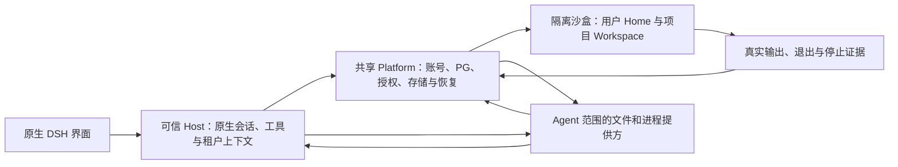

# 原生 DSH 云端运行改造计划

本计划承接已完成的[迁移](CLOUD-MIGRATION-PLAN.md)，处理试用发现的命令等待、原生权限和插件能力缺失。用户已授权统一协调三个会话、形成方案后实施，并要求每个纵切面完成后系统可用。当前开发分支为 `power-evolve/native-cloud-runtime`；既有试用实例在候选版本验收前继续运行。

## 已确认的问题

当前 Host 只组合了部分原生服务，并手工选择浏览器接口。原生权限选择器缺少权限服务、命令、设置和会话投影；部分插件的图标及翻译资源没有进入镜像。命令工具返回持久接收回执后结束当前轮次，Platform 再把执行结果作为新消息续跑。这改变了原生 Bash 工具等待真实结果的行为，沙盒冷启动和基础设施故障会放大体验差异。

原生 `fs`、`subprocess`、`shell` 和 `sandbox` 接口允许替换执行提供方。原生工具、权限及插件业务应复用这些接口上方的维护实现；账号隔离、云端存储、租约、执行身份及恢复由产品平台提供。完整能力需要文件和进程处于同一执行环境，单独补一个页面接口不构成完成。

## 运行边界

第一阶段保留可信 Platform、Host 和现有 PG 持久事件，不把可信 Harness 放进可执行用户命令的沙盒。执行提供方按 Agent 的操作授权绑定，不使用共享的“当前用户”。Platform 保管数据库、模型和 Kubernetes 凭据，沙盒仅接收该用户的环境、项目文件和有界执行请求。

每用户可信原生运行实例是完整装配的优先验证路线。原生 Settings、Profile 和子会话的进程级所有权更适合独立租户实例；共享 Host 的完整隔离上下文作为备选。两个会话的核查均表明单独替换 Shell 不足以恢复这些能力，因此同时启动原生运行实例的配置隔离实证。该实例仍与不可信命令执行环境分离，不把平台凭据交给用户进程。首次切换先测资源、权限和恢复；不能以新部署形态替代验证。

## 纵切面与分工

每片独立提交、按受影响行为测试，再在隔离候选实例验收。缺失、跳过或历史测试不计作当前通过。主协调会话负责集成和部署，另两个会话不独立切换试用环境。

| 切片 | 用户可见结果 | 开发责任 | 验收条件 |
| --- | --- | --- | --- |
| S0 运行资源 | 原生插件显示实际图标和翻译 | 插件会话 | 声明资源进入正式包；错误或越界图标路径拒绝；已有页面可用 |
| S1 原生前台命令 | Bash 调用保持运行，真实结果返回同一工具调用后继续任务 | 主协调：原生 Shell；权限会话：Platform 持久执行 | Python 创建、运行、读回；非零退出；冷启动；取消与超时；账号拒绝；无重复续跑或副作用重放 |
| S1b 租户原生装配 | 完整原生设置和插件服务归属于各自用户 | 插件会话 | 两个具名原生运行实例；实际原生接口与配置变更隔离；无共享平台凭据；测启动与空闲开销；未完成执行隔离前不切试用 |
| S2 文件与权限 | 文件和命令使用同一环境，原生权限选择有实际约束 | 权限会话与主协调 | 原生设置、命令和投影；默认只影响新会话；物理只读、工作区写入及越界拒绝；恢复和不同账号隔离 |
| S3 原生插件能力 | Terminal、Agent loop、Subagents、Web search 使用共同云端能力 | 插件会话与主协调 | 四种能力真实调用；各会话及账号状态隔离；停止、恢复和原生显示；不只交付配置卡片 |
| S4 集成交付 | 可部署、可回退的验收版本 | 主协调 | 同版本核心回归；MCP、PDF、沙盒与会话恢复；独立审查；源码、镜像、配置和验收记录对应 |

S1 首先提供有界前台命令。未验证的后台进程、PTY 和 LSP 不宣称完成；S3 通过共同进程能力接入这些实际消费者。旧回执式执行保持原恢复路径，新前台执行使用明确持久交付方式，不能依据工具名称或临时内存状态猜测是否生成续跑消息。

## 本轮实施状态与后续选择

S0 的插件显示资源已切换到试用 Host。资源导出进一步改为复用 npm 的包文件选择规则，包括原生 Profile 预设和依赖链接，并拒绝越界资源。S1 已组合原生 Bash、Shell 和截止时间库；新执行保持原工具调用，首次停止原因落库，观察异常和 Agent 释放均等待精确清理。数据库以保留相邻代的方式升级，候选先使用独立数据库和存储，当前试用数据尚未升级。

双完整原生 Runtime 实证已返回各自的 19 个配置命名空间和 188 个插件条目。启动和空闲资源测量支持继续验证该方案；配置写入、重启恢复及执行隔离仍须分别验收。不能把这个结果当成四项插件的真实执行通过。

S2 优先核对并复用官方 SSH 提供方家族已有的 Fs、Subprocess、PTY 和 Sandbox 实现。SSH 在此只是内部执行传输，不恢复原计划排除的用户 SSH 插件。上游 helper 默认使用本地进程提供方，没有用户程序降权选项；文件权限策略也不能隔离进程和控制令牌。先验证可信 helper 与不可信程序的身份、进程和通道隔离，再确认复用范围。验证不通过时替换下方提供方，不能以配置卡片或目录权限宣称完成。

## 质量与切换

当前基线和历史验收资料保留。每个候选版本记录确切源码、配置和测试证据；行为故障阻塞切换，覆盖率不足按既有范围登记。执行状态未知时保留原请求和身份，先核对原 Runner 与 Pod，禁止自动重放可能产生副作用的命令。

首次切换前备份现有试用数据并验证版本兼容。涉及数据库新代的候选先用独立数据库；不能将已升级数据库交给旧版本运行。切换后确认登录、项目、对话与受影响功能，失败时按已验证的镜像和数据恢复路径回退。

明日验收记录报告已完成的切片、运行入口、真实证据和未完成项。首次真实执行、隔离和恢复验证前不给整套重构的确定完成时间；通过后依据剩余切片重新评估。
