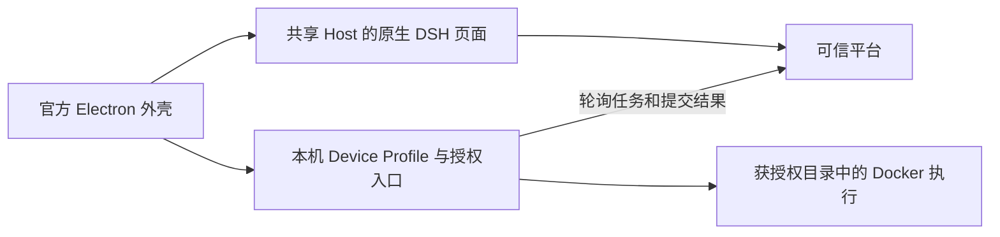

# 原生 DSH 桌面复用实施约定

本文固定[交付计划](DELIVERY-PLAN.md)的 Mac 桌面路径，是待实施方案。当前 [`baseline.json`](baseline.json) 所记录官方基线的 `apps/desktop` 与 `apps/desktop-host`，和产品仓中的对应目录树完全一致；复用以该固定源码为依据，不声称核验了远端最新版本。早期桌面实测见[原生桌面试用](TRIAL-NATIVE-DESKTOP.md)，不能替代当前正式 Profile 和安装包验收。

2026-10-04 已取回 fork 的 `origin/master` 并只读比较桌面更新：新增登录 shell 环境、CLI 管理及相应发行逻辑；本计划涉及的 Profile 管理、Host 子进程、backend 控制器、退出检查和包集合准备实现未变。它们仍需下述产品适配；这次源码比较不升级当前固定基线，也不代表新上游桌面产物已通过产品测试。

## 复用范围

| 官方组件 | 产品处理 |
| --- | --- |
| [Electron 主入口](../../apps/desktop/src/main.ts)、窗口、菜单、主题及关闭管理 | 保留原生外壳；新增受控产品启动选项 |
| [子进程控制器](../../apps/desktop/src/backend-controller.ts)、[Host 生命周期](../../apps/desktop/src/host-process.ts)与 [Profile 管理](../../apps/desktop/src/project-manager.ts) | 复用启动、失败及退出控制；产品另选 Device Profile、入口和 readiness 协议 |
| [Preload](../../apps/desktop/src/preload-app.ts)与 [IPC 校验](../../apps/desktop/src/ipc.ts) | 固定产品 Origin、所属窗口和主 frame；只暴露必要原生能力 |
| [目录选择](../../apps/desktop/src/directory-picker.ts) | 复用 OS 选择能力，接入 Device 本地授权；云端只获得目录 ID 和标签 |
| [Office 资源](../../apps/desktop-host/src/office.ts)及 [资源解析](../../apps/desktop-host/src/office-engine.ts) | 复用材料和资源定位机制；实际产品执行仍走获授权 Device／Runner |
| [ARM64 打包](../../apps/desktop/scripts/package-target.ts)及 [闭包准备](../../apps/desktop/scripts/prepare-package-set.ts) | 复用目标检查和包摘要；显式收集 Device 产品包，并分别固定产品、上游 runtime 版本及私有目录 |

现有 PowerEvolve cloud-web 已装配账号、工作区、文件、产物、扩展中心及执行位置，桌面加载这些原生 DSH 页面。官方 Mac 使用 Dock，Windows 托盘实现不作为本轮新增 Mac 菜单栏托盘的依据。

## 三个产品适配器

1. **Cloud carrier**：窗口直接加载固定共享 Host 的原生页面，客户端静态资源与 RPC 同源，版本随共享 Host 发布。本轮保留用户授权的 loopback HTTP，生产保留 HTTPS 校验。直接使用产品浏览器认证、cookie、Origin 和 WS 规则；官方 `dsh-app` 本地代理期望不同的启动 cookie，不能原样代替产品登录。产品 Preload 只暴露必要窗口能力和打开本地授权入口的动作；导航和原生 IPC 只接受准确 Origin、所属窗口及主 frame。官方导航及[麦克风授权](../../apps/desktop/src/microphone-permissions.ts)也按产品 Origin 适配，保持原生语音输入的系统授权与窗口限制。
2. **Device process**：通过 DSH Profile 启动独立 Device，持久保存其 private state、journal 和固定 Runner 版本。Device 适配器实现现有 [backend 控制器](../../apps/desktop/src/backend-controller.ts)的 `start/stop`，由产品入口启动明确选择的 Profile、可信 bundles 和安装解析锚点，再核验 Device readiness。官方启动代码固定选择本地 Web bundles 与 desktop-host，不能仅替换服务 URL。Electron 关闭仅处置所拥有的本机执行，不把云任务当作本地子进程。复用原生启动失败、退出等待和重启检查；不在 Mac 启动共享平台或另一套云 Agent。
3. **Local Device bridge**：打开所属 Device 的本地配对及目录授权入口，复用现有 `/api/choose`。本机绝对路径、nonce 和设备凭据留在本机；Cloud renderer 只消费设备／目录 ID 和标签。拖入本机文件时使用明确授权传输或本地目标，不转换为云端可读取的绝对 `@path`。

这些是产品适配代码，不是三个新的 DSH 插件。Cordis 插件复用现有 Device Bundle、云端 Host 与客户端能力；Electron 的入口、Preload／IPC 和打包选择需要另外提供最小装配接口。官方默认启动方式保留，产品模式显式选择入口、Profile、私有根和发布配置，并记录实际修改文件的升级影响。官方 DeepSeek 账户桥与产品身份、审批凭据分别保留其职责。

## 官方代码的装配接口

产品入口放在 `products/power-evolve/desktop/`。官方主入口有应用启动副作用，窗口工厂目前是私有函数；产品不能通过导入该入口复用窗口，也不能只替换 URL 后沿用官方本地 Host。以下扩展保留官方默认行为，产品仅显式选择配置与实现。

| 接入点 | 复用方式与产品职责 |
| --- | --- |
| [窗口工厂](../../apps/desktop/src/main.ts) | 提取无启动副作用的窗口模块，注入 Preload、Electron Session、语言及导航许可；复用尺寸、Mac traffic lights、vibrancy、全屏和上下文菜单 |
| [快捷键](../../apps/desktop/src/keyboard.ts)与应用菜单 | 页面许可增加显式参数；保留所属窗口、主 frame、原生按键和用户配置。产品菜单复用原生 File／Edit／Window 与退出动作 |
| [麦克风](../../apps/desktop/src/microphone-permissions.ts) | 注入精确 Host 页面许可，保留 audio-only、所属主窗口与 Mac 系统授权；平台登录页不获录音许可 |
| [主题](../../apps/desktop/src/preload-theme.ts)与[平台／全屏标记](../../apps/desktop/src/preload-platform.ts) | 直接复用；产品 Cloud Preload 同时装配原生页面所需的快捷键接口，避免只有平台标记而缺少 bridge |
| [后端控制器](../../apps/desktop/src/backend-controller.ts) | Device 适配器实现 `start/stop`；另选产品 Profile 与 readiness，不修改控制器来启动共享平台或本机云 Agent |
| [包闭包准备](../../apps/desktop/scripts/prepare-package-set.ts) | 保留收集和校验机制；产品固定独立入口、Device 依赖、私有配置及物理辅助资源，正式更新另选产品发布源 |

Cloud 主窗口和固定平台登录页面使用同一个 Electron Session，IPC 许可仍只属于 Host 主 frame。账号页面返回 Host 根地址时，承载器将该固定目标规范到 `/native/`；`hostOrigin` 始终保留准确 Origin，不把路径加入 Origin 配置。原生侧栏浏览器和更新能力按实际客户端消费接口装配，不能仅填充空 bridge 或让 Cloud 页面调用未安装的 IPC。

当前产品客户端只要求 `dshDesktop` 的 `protocolVersion`、完整 `keyboard` 与 `shortcuts`，主题通过原生 DOM 属性同步；产品以明确的部分接口声明，不强转为官方完整 `DshDesktopProductApi`。首个桌面切片不装配未接入的 `browser/updates`，关闭 `webviewTag`。以后接入原生侧栏浏览器时复用[所属 guest 管理](../../apps/desktop/src/browser-guests.ts)，增加 Host、平台和 Device 地址拒绝，以及登录身份更换后的分区清退；renderer 提供的 workspace 字符串不能成为共享 Cloud 用户身份。

本地授权入口使用单独的所属窗口和 Preload；配对、路径与 nonce 留在该窗口及 Device 进程。Cloud renderer 不接收原生选择器返回的路径，也不获得通用本机文件读写或命令 IPC。官方 Preload 的 `__DSH_HOST_PATHS__` 将本机拖拽转成绝对路径引用，产品 Cloud 模式不装配它；上传通过明确传输进入用户云工作区，本地引用通过已授权目录 ID 和相对路径定位。

Cloud 主窗口在同一 Electron Session 中完成固定可信平台的登录／强制改密码导航，再返回共享 Host。导航许可分别核对 Host 和平台入口，原生能力的 IPC 仍只授予所属 Host 主 frame；平台登录页不获得设备桥。这样[现有登录交换](application/web/login.js)写入的产品 cookie 留在正确会话中，注销与凭据失效后的重新登录也能使用同一链路。

## 可试用的实施顺序

Device 文件和写入协议稳定后，按下面三个纵切面集成 Electron；每一步沿用正式原生页面，完成验收再进入下一步。

| 步骤 | 复用和适配 | 本步验收 |
| --- | --- | --- |
| 桌面登录与对话 | 原生窗口、菜单、主题；装配 Cloud carrier 与产品 Origin／cookie／WS | 两账号独立登录、`hi`、刷新、退出再打开；没有本地 Agent 或执行容器 |
| 本地执行 | 后端控制器与子进程生命周期；装配 Device Profile、本地授权窗口和目录选择 | 配对、选择／取消目录、本地 Git、撤销、崩溃恢复和退出；外部页面与 iframe 调用桥被拒绝 |
| 安装包 | 目标检查、包闭包校验及 runtime 准备；显式加入产品 Device、辅助资源和原生依赖 | Mac ARM64 包在源码树外启动、连接共享 Host、本地执行、退出与再打开；记录签名和依赖要求 |

## 退出与发行约束

官方[退出检查](../../apps/desktop-host/src/quit-inspection.ts)只观察本机 Agent、jobs 和已加载提醒；[退出确认](../../apps/desktop/src/quit-confirmation.ts)在 backend 未 ready 时允许直接退出。产品检查以 Device 持久 journal 和不可变容器身份为依据，Device 崩溃或状态未知不能视为空闲。退出／更新先停止本地任务准入，再按所选退出策略核实既有任务和停止回执；子进程等待期限按 Device 停止、观察及上报的配置选择，超时后保留未确认记录，进程退出 ACK 不代替容器停止证明。关闭窗口不会取消云端任务，停止证明缺失时不能把任务标为完成或放行替代写入者。

官方[包校验](../../apps/desktop/src/core-package-set.ts)、[runtime 准备](../../apps/desktop/scripts/prepare-dsh.ts)和[运行验收](../../apps/desktop/scripts/smoke-runtime.ts)绑定本地 Web Host 与同版本 DSH／desktop-host。产品发行另固定 Device 包闭包、产品版本与上游 runtime 版本，并验证离源码启动 Device 和连接共享 Host；官方 smoke 通过不替代产品安装包验收。

产品应用 ID、Electron userData、DSH Home、Device 私有根与更新源独立选择，避免与官方 DSH 安装共享身份或数据。复用[自动更新机制](../../apps/desktop/scripts/desktop-auto-update-environment.mjs)时指定 PowerEvolve 发布渠道和签名校验；当前官方生产更新地址及账户策略不能直接作为产品发布配置。Device 启动确认同时绑定当前所属子进程和新的实例标识，旧 readiness 文件或 HTTP 端口可达不能证明当前 Worker 已 ready。

Device 的 [Python 文件辅助脚本](application/src/device/local-files.ts)由外部 Python 执行，必须位于物理资源目录。[官方 ASAR 规则](../../apps/desktop/scripts/electron-builder-config.mjs)未解包该脚本；产品包闭包须显式保留脚本并选择解包或资源复制及物理路径解析。`pythonExecutable` 指向已验证的安装包 Python，不能依赖开发机 PATH；Office 的资源解析不覆盖这个辅助脚本。

Device 已接入上游原生 `flock`、不可变 Docker 身份、启动前持久记录、跨 Device 写入槽及描述符相对文件访问，生命周期由 [Device Bundle](device/README.md)描述。平台已固定原请求和进程派发、发放一次启动许可、保存精确容器登记及撤销后的受限停止回执，并限制同 Device／目录授权的跨会话并发。已有完整停止记录的未知执行可经独立审批结案；尚未发放启动权限的冷领取及创建可永久封存，另行持久清理迟到容器。真实 PG／Docker 范围见[派发与停止记录验收](deploy/QA-DEVICE-DISPATCH-STOP.md)、[未知结果结案验收](deploy/QA-DEVICE-UNKNOWN-CLOSURE.md)、[写入与文件验收](deploy/QA-DEVICE-WRITER-FILES.md)及[冷领取封存验收](deploy/QA-DEVICE-CLAIM-CLOSURE.md)。Electron 的三个产品适配器及安装包仍未交付。

[创建回执前的真实进程崩溃验收](deploy/QA-DEVICE-CREATE-RECOVERY.md)覆盖实际 Worker 在 Docker create 前后遭 SIGKILL。替代 Worker 永久封存原执行，不登记原容器或发放首次启动许可；迟到容器清理期间新的真实 Git 任务可以继续，写入槽保持原新任务身份。该结果属于 Device 协议验收，不替代 Electron 生命周期；放行依据是平台永久禁止原启动与持久清理记录，不能由一次 missing 查询代替。

## 业务与开发顺序

Cloud 不确定执行结案与 Device 启动前永久封存已有协议验收。接下来将 operation 固定的技能版本、只读包挂载、Office 和进程连接器接入获授权本机目标。远程 HTTP API 继续由可信平台保管凭据和执行；不能通过放开 Host 本地 shell 补齐桌面功能。

Root 固定共享 DTO、schema、Profile、Electron 扩展点及发行闭包；设备实现者负责 Device/目录/包交付；Host 实现者负责模型工具目标；客户端实现者复用原执行位置与扩展中心。接口与文件归属固定后并行实现，真实端到端验收和版本冻结串行完成。桌面承载器在业务协议稳定前仅做只读审计，不提前合入下一切片。

## 完成出口

- 当前正式原生页面在 Mac 窗口登录两个账号；云端 `hi` 不创建执行容器，刷新及再次启动可恢复历史。
- 本地配对、目录选择／取消、撤销、越界拒绝及显式云／本地传输；云端不能拿到本机路径或设备凭据，外部导航与 iframe 不能调用设备桥。
- 同一产品分别完成云 Git 和本地 Git；技能固定版本及 Word／Excel／PPT 各有真实本机成果读回，连接器显示实际目标并保留审批边界。
- 运行中 Device 断联／重启，不重放原命令；核实停止后原会话至多一次续接，另一个用户不能访问该执行或目录。
- ARM64 产品包离开源码树安装、启动、退出及再打开；固定包闭包、设备镜像、技能版本和独立私有配置，记录实际签名状态。生产公证及独立物理多节点另保留其未验收范围。
