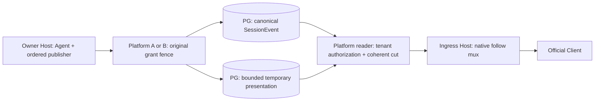

# 员工7：跨 Host assistant-stream 最小实现方案

本方案供 root 下一批实施：Owner Host 将真实 Session append 与官方临时 assistant frame 放进同一个有界发布队列，Platform 在同一 PG 事务中验证原 grant/epoch、提交 SessionEvent 并更新临时 presentation 状态；接入 Host 读取这一已提交顺序，输出官方 follow frame。两组 Host/Platform 共用 PG，因此浏览器无需连接运行 Agent 的 Host。方案尚未实施或执行行为验收；本次只读代码，未改冻结 wire fixture、生产或配置。

官方依据为 `dsh-v0.2.1-alpha.1` / `5badb15009ae1756c3afe0ae0cef1faafc290ccc`。20份官方文件已从该 Git object 独立保存；当前17份完全相同，3份差异另存。Gateway根部的mux公开导出是当前产品补丁，不是固定tag的根部导出；其底层opener/control/pump代码与固定tag相同。固定tag的SessionController accumulator及wire转换函数只能作行为参考，本方案只用正式公开的Agent事件、Agent setup、LLM accumulator、Session follow类型及当前已有carrier导出，不新增上游源码深层导入。

## 原生类型与公开 API 证据

下面官方行号以固定tag为准，未特别注明的官方文件在读取时与tag完全相同；产品行号对应私有`current/`只读快照。完整源码副本、SHA和当前补丁差异在仓库外 `power-evolve-migration-evidence/employee7/assistant-stream-proposal-20261009-aknbgfno/`；39个初始记录输入包括3个冻结wire文件，另有7个补充输入，不是全部依赖闭包。审查期间scheduler/persistence/tasks/contracts有其他线程修改，完整diff保留；方案没有把这些输入称为统一冻结，3个wire文件前后未变。

| 来源及行号 | 必须保留的行为 |
| --- | --- |
| [Agent runtime-types.ts](../../packages/core/agent/src/runtime-types.ts) 128–160、355–363 | `agent/assistant-stream`是同步emit的`start/chunk/end`；revision只在一个Agent生命周期内递增，replacement从1开始；chunk有attemptId/index/time和真实StreamChunk。不能从emit监听器返回Promise来暂停模型。 |
| [Agent index.ts](../../packages/core/agent/src/index.ts) 45–54、100–118、171–202 | `resume({setup})`在Agent发布、queued work释放前安装作用域监听器，拿到准确Agent对象；setup不能驱动Agent。不能等resume返回后才订阅首个start。 |
| [AgentLoop assistant-stream.ts](../../packages/core/agent-loop/src/assistant-stream.ts) 45–69、78–107 | attemptId仅Agent生命周期内唯一；`settle`先调用同步Session append，再emit committed end；abandoned是原生源明确无法提交时发出的结果。 |
| [LLM assistant-stream.ts](../../packages/llm/llm/src/assistant-stream.ts) 99–110、179–202；[LLM index.ts](../../packages/llm/llm/src/index.ts) 50 | 公开`AssistantStreamAccumulator.push/snapshot`和`expandAssistantStream`保留chunk边界、time、reasoning/text/tool-call；compact不等于总大小有界。 |
| [Session types.ts](../../packages/api/session-controller/src/types.ts) 486–543、552–563 | follow opt-in为`assistantStream:true`；snapshot含revision及可选activeAttempt，start另含startedAfterSeq；end必须是committed(eventType/seq)或abandoned。presentation不是SessionEventEntry。 |
| [官方 history.ts](../../packages/api/session-controller/src/history.ts) 146–202、214–239、283–292 | opening有一致的durable cut与assistant cut，监听先安装、snapshot前已有frame不重播；后续durable事件连续；取消释放监听器。仅用于行为参照，两个私有helper不作为产品导入API。 |
| [Client transport.ts](../../packages/api/session-controller/src/client/transport.ts) 178–218 | opt-in缺opening baseline直接报错；后续revision必须严格等于上次+1，跳号产生carrier错误。不能在同一follow里静默把revision重置0/1。 |
| [Client assistant-stream.ts](../../packages/api/session-controller/src/client/sessions/assistant-stream.ts) 58–99、109–119、129–194、211–217 | reconnect展开compact prefix；durable settlement先暂存，收到end才关联释放；成功消息的临时行到step/end才退役。把整个PG suffix先发完、再补start/chunk/end会破坏此顺序。 |
| 固定tag [Gateway stream-server.ts](../../packages/api/gateway/src/stream-server.ts) 15–27、225–292 | opener收到公开形状的AbortController；Remote失败reason会发error，普通abort只取消。pump每项await socket.send回调；`streamInboxBytes`只限uplink，不提供浏览器消费ack或downlink字节额度。当前差异仅reject-upgrade增加503。 |
| [Gateway journal-stream.ts](../../packages/api/gateway/src/client/journal-stream.ts) 115–122、269–303；[remote-stream.ts](../../packages/api/gateway/src/client/remote-stream.ts) 126–146 | 有有效opening后正常end会成为可重试carrier失败，重新follow；opening前end是协议错误；Remote service-unavailable错误是terminal，不会自动重试。 |
| [Gateway stream-client.ts](../../packages/api/gateway/src/client/stream-client.ts) 122–143、366–391 | server error转为RemoteError，cancel由消费者signal发出；Client inbox本身没有数量/字节额度，不能把Server send回调当浏览器消费完成。 |
| 固定tagGateway `index.ts` 386–421；[当前 Gateway index.ts](../../packages/api/gateway/src/index.ts) 20–22 | 固定tag公开Gateway.stream返回cancellation-aware iterable；当前产品另公开mux类/type，产品native carrier已依赖此补丁。方案不能宣称这三个root export属于原tag。 |

原生wire只输出三类：opening `snapshot`、实际已提交的 `{type:'event',event}`、`{type:'assistant-stream',frame}`。start保留原attemptId/revision/turn/step，startedAfterSeq是该start之前已提交的真实cursor；chunk保留原revision/index/time/chunk；end保留原index和原生outcome。不生成`assistant/live-chunk`持久事件、不改seq、不重新切块或重写timestamp，不用空结果冒充已有attempt。空revision0仅用于权威确认没有可恢复presentation的全新opening，不能替代运行中存在的prefix。

## 当前产品约束

[Scheduler](application/src/host/scheduler.ts) 114–162在claim后登记原grant、renew并resume；222–246先dispose/drain再finish并删grant。[PlatformHandle](application/src/host/persistence.ts) 49–74、85–95将同步Session event异步串行发往PG，flush/close才报告写入失败。因此原生本地committed end不是PG提交确认，直接监听并跨Host转发会过早宣告durable成功。[EventStore](application/src/platform/events.ts) 33–59已有精确append去重、seq/历史容量、checkpoint同事务；[TaskStore](application/src/platform/tasks.ts) 357–364、409–442对grant digest/epoch/PG clock及锁等待后有效性重新核验，471–485最终释放lease。这些规则必须复用。

[RuntimeScope](application/src/host/scope.ts) 的grant属于执行Host；接入Host不能通过`runtime.require(sessionId)`取得另一Host的grant。[当前 follow](application/src/host/native-remote.ts) 411–414、435–443只传mux control.signal并轮询PG；[NativeSessionRead.snapshot](application/src/platform/native-session-read.ts) 98–112仍固定返回revision0，[follow helper](application/src/host/native-session-follow.ts) 30–52只发durable事件。已有[2+2记录](TRIAL-M3-REPLICAS.md) 7–11证明共享PG和跨Host请求/读回，明确不包含事件流重连或背压。

## 最小接线与授权

新增product私有publisher与Platform presentation store；一个新有版本的私有PG对象保存当前generation、bounded compact attempt、bounded ordered ring和最新batch receipt。generation为Session id＋server epoch＋随机publisherId，绑定实际Agent对象及原operation。PG owner/worker从pe_attempts推导；workerId、epoch和Session id的客户端字段不构成授权。原grant token仅作请求凭据，不写入presentation正文或发给浏览器。临时存储不是native日志、恢复来源或永久聊天历史；claim、finish和恢复清理都按Session/epoch/PG clock处理。

临时payload使用有版本的JSON文本列或现有checkpoint encoding2的JSON字符串封装；SQL只处理owner/epoch/ordinal/TTL等结构列，不对合法NUL/surrogate的chunk内容做jsonb文本提取。严格验证完整JSON、原生packed stream及额度后才materialize baseline，保留UTF-16与原chunk边界，不新增unknown/any断言。

Owner在`agents.resume({setup})`内按准确Agent安装assistant listener；原生Session event进入PlatformHandle时和assistant frame共用一个serializer，分配私有递增publication ordinal。一个建议端点`/runtime/presentation/apply`接收有界batch：真实native append items及原始assistant items；只有一项请求在途。Platform先按现有account→Session锁顺序调用TaskStore.authorized，再锁presentation行，核对server epoch、publisher、ordinal、dense revision/index、attempt、事件parser和总额度；最终mutation还以原digest/epoch、running operation及`clock_timestamp()`核验lease有效，失败回滚整个batch。真实事件仍提交到pe_events；需把EventStore既有append事务主体提取成共用的client内部操作，避免嵌套事务或两个分离的提交。

同一事务按batch顺序处理事件与frame：start的startedAfterSeq取此刻已提交prefix；committed end必须找到该Session前面已接受的真实eventType/seq，核对turn/step和compact stream，并在事务成功后才可读到end。ring只存durable event引用及临时frame；浏览器event内容从canonical PG log验证读出，不信任一份presentation复制。批次重试只接受最后receipt的相同batchId和完整相同内容；修改内容、跳ordinal、过旧且已无法核对的receipt拒绝，不能只凭lastOrdinal假定所有重试成功。事务失败不推进任何一个cursor，不伪造abandoned或最终消息。

接入Host使用浏览器账号凭据调用建议的`/native/sessions/follow-open`和`follow-after`，每次读重新鉴权、锁定本人Session、读取同一PG事务cut内的durable窗口、checkpoint及presentation；读者不持执行grant。Host保留私有generation/ordinal/revision，仅输出原生字段。ring按统一ordinal合并：真实event在原发生位置发出，settlement必须在end之前，step/end必须在其后，不能把独立event轮询结果整批放到所有chunk前面。`assistantStream`未opt-in时继续durable-only读，不启动Agent或owner转发。

## revision、重连与有界背压

原Agent revision/index不改号。epoch或publisher变化、ring已淘汰reader尚未消费的ordinal时，已发有效opening的follow正常return；mux发end，官方journal supervisor按既有规则重新opening，在当前PG cut取得真实compact prefix和nextIndex。不依赖向Client发503自动重试，也不在同一代插入第二个snapshot或重置revision。opening前状态无效、授权拒绝、数据损坏或额度拒绝发明确terminal error；不能先发假opening来获得retry。上次durable cursor不倒退，已存在的terminal event不能与旧active prefix一起作为opening再次显示。

公开mux没有消费ack。最小方案在每个follow generation设置发出item数、累计UTF-8 JSON字节及寿命上限，opening也计入；达到上限后在已完成opening的前提下正常end再取新baseline。这样慢Client未消费一代end时不会打开下一代，限制这一logical stream的Client inbox；需要全Host/maxStreams和所有product stream的总数约束，不能把仅follow的限额推广为全部carrier都已限流。它是有额度的rebaseline，不能称消费ack或模型流暂停。viewer缓慢只淘汰reader/presentation ring，不取消Owner的业务turn。

以下为待root结合既有request/response配置落定的起始额度，均必须正整数、独立计数并在实际分配前检查：owner queue≤256 items/2MiB；batch≤32 items、目标256KiB；单assistant frame≤256KiB；compact attempt≤4MiB；ring≤1024 items/4MiB；opening≤4MiB；每generation≤256 items/8MiB含opening，正常取数每20秒重新opening。真实native event继续原maxEventBytes/history规则；queue、合法单事件batch与Platform body cap须容纳该事件及封装开销，不能用presentation目标额度收紧已支持的native持久写。frame同时小于Platform request cap，opening小于RuntimeScope response cap。限制序列化后的bytes和record/chunk数；压缩/compact、maxStreams或poll间隔不等价于字节额度。ring淘汰不碰canonical事件；超opening/attempt额度不能用截断prefix、空baseline或部分成功掩盖，须明确拒绝该presentation。

固定公开API不能给一个已经挂起的`socket.send`回调提供20秒硬截止；control.abort也不会中断该private send Promise。此限制必须保留。若要求硬期限及确定的挂起write清理，root需在当前已有Gateway mux补丁中增加一项可选、typed downlink预算API，由product必填：每frame/每connection排队bytes、send timeout，在超限时终止受影响的physical carrier并等待原write/iterator结束。该carrier的所有logical streams会重连，其他carrier及Owner业务不变；不读Gateway私有字段、不承诺只取消一个已挂起write。这是明确的新补丁范围，不能把它算成现有fixed-tag公开能力或当前验收通过。

同步emit不能等待网络。serializer入队超限必须保留首个失败并进入明确失败/停止发布路径；共用的durability queue若无法再接收真实事件，Scheduler按现有写入失败/Agent取消/flush拒绝处理，不能继续声称成功。Platform暂时不可达只在有界queue及有限重试窗口内重试同一batch；迟到旧epoch永远拒绝。presentation liveness由发布/有界heartbeat单独维护且不晚于lease deadline，不能用普通renew无限延长已停止发布的旧prefix。读者遇过期状态重新opening或明确拒绝，不补造end。

## 终止与恢复

Owner publisher在Agent dispose/quiescence期间继续接收原生终止frame；setup监听器清理不取消已经承诺的提交。Scheduler在原handle.dispose之后、runtime.finish之前seal/drain publisher，保留原始失败；最后停止heartbeat、解除监听器、清queue/receipt及准确generation。PG写入失败、lease lost、Host崩溃时不代替原生源生成abandoned；读者以epoch/liveness识别退役generation，重取真实durable记录。迟到close只清它自己的epoch/publisher，不能删新Owner状态。

Reader cancel、正常代结束、socket/Peer disposal必须停止poll和pending read、归还iterator并释放timer/listener；传mux control.signal至实际RuntimeScope fetch。Server需要传Remote失败时使用带RemoteError reason的control或正常throw，普通control.abort本身不向仍等待的Client保证送end。reader的HTTP/mux取消与业务session/cancel分开，断开浏览器不取消模型或删除queued输入。

备份恢复后的临时presentation统一丢弃/失效；native事件原字节及正常claim恢复规则保留。运行中已消费输入不能因丢失presentation自动重放模型，沿用原operation/uncertain规则；新epoch需新的Agent publisher与完整opening。这里不扩展subagent follow，当前root address范围不能当作官方subagent能力通过。

## 必须执行的真实用例

| 范围 | 必须观察的结果 |
| --- | --- |
| source：实际Agent + scripted adapter | setup订阅早于恢复queued work；首start不丢；text/reasoning/tool-call均有dense revision/index、原time；成功、adapter失败、取消前后、重试多个attempt与step/end顺序符合官方Client。仅此层允许模型替身。 |
| PG：原grant、两连接锁等待 | lease过期、账号禁用、epoch替换、伪worker/publisher、跨Session发布在锁等待后拒绝；pe_events、checkpoint、presentation及receipt不部分推进。 |
| PG：append/end提交屏障 | 延迟或拒绝真实append事务时，跨Host看不到committed end；成功后event确实存在且内容/seq/compact stream一致；错误不能变abandoned成功。 |
| PG：批次重试/乱序 | 实际提交后丢ack，再以同batch原内容重试只有一次效果；改内容、跳ordinal/revision/index、错误attempt/terminal seq均拒绝；排队输入不改写。 |
| PG＋Host：opening并发 | start/chunk、最终append/end、finish与opening同时发生；cursor/checkpoint/baseline来自一致cut，已完成attempt不显示旧prefix，首live frame恰为baseline revision+1。 |
| 2+2＋官方Client/browser＋真实模型 | Owner A经Platform A发布，Client接Host B经Platform B看见终止前真实delta；最后模型文本只出现一次，durable原字节相同，grant不出现在Client流量。交换四个角色重跑。 |
| 官方Client真实重连 | 中途换接入Host、换Platform、socket断开、owner epoch更换及ring落后；正常end确实自动重新opening，503确实terminal；prefix/nextIndex恢复，无假revision0、重复delta或幽灵成功消息。 |
| 真实慢consumer/并发stream | consumer不拉next时，已收item/bytes不超过一代额度＋terminal envelope；owner继续完成；quota rebaseline不改revision；maxStreams和queue/ring/compact内存分别有上界；暂停实际socket读，另证新增send deadline终止该carrier并drain，不能只测socket.send调用成功。 |
| PG＋实际断开/撤权 | reader abort令pending RuntimeScope fetch取消，iterator/timer/listener归零；只关闭该logical stream；cookie撤权在下一次授权读拒绝；Owner和其他用户不受影响。 |
| PG＋故障/清理 | owner发布超限、Platform不可达、Host杀死、dispose首失败、finish前断链、TTL到期及restore失效均无伪terminal/晚到清新generation；已消费请求不重放。 |
| Unicode与native packed stream | NUL、lone surrogate、emoji、工具参数delta、reasoning和同时间chunk经过PG临时codec/reconnect精确保留；z.json/官方JSON与compact验证，不新增unknown/any断言。 |
| 正式Profile与质量 | 同一冻结源码构建的具名2+2 Profile、正式resolver及实际浏览器执行上述路径；source类型、typed lint、必要组件行为及四项逐文件100%分别记账。旧wire16和历史2+2都不计本功能通过。 |

实施范围建议为product publisher/store、新私有有版本DDL/配置、Scheduler setup及dispose、PlatformHandle共用serializer、EventStore同client操作、native follow coherent读与限额，以及有硬write截止要求时的上述小Gateway预算API补丁。root拥有这些生产/配置/发布变更；员工7本轮只提交方案和证据，不启动Agent、PG、Profile、浏览器或新测试，不改当前冻结三文件。
