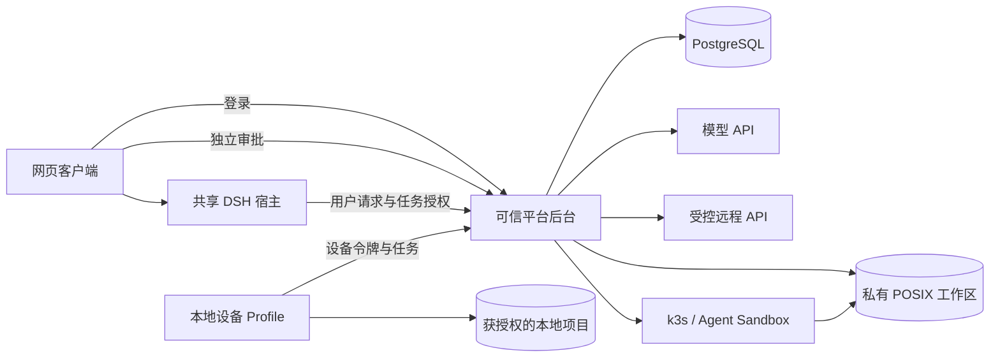

# PowerEvolve

English | [中文](README.zh.md)

PowerEvolve lives separately from upstream DSH within the same repository. Start development with the [architecture decision](ARCHITECTURE.md), or use the [desktop and cloud trial guide](TRIAL-SLICE5.md). Earlier [slice 4](TRIAL-SLICE4.md), [slice 3](TRIAL-SLICE3.md), [slice 2](TRIAL-SLICE2.md), and [slice 1](TRIAL.md) trials remain isolated.

| Directory | Responsibility |
| --- | --- |
| `application/src/host` | User RPC, event subscriptions, scheduling, native Session persistence and model adapters |
| `application/src/platform` | Identity, ownership, PG transactions, task leases, events, credentialed calls, and Sandbox management |
| `application/src/device`, `device` | Local-only device UI, directory grants, durable command journal, and bounded Docker execution |
| `application/web` | Conversation, files, skills, execution target selection, and a separate trusted approval page |
| `sandbox`, `k8s` | Per-Sandbox command runner and namespace-scoped platform RBAC |
| `host`, `platform` | Plugin composition and deployment settings for the two DSH Profiles |
| `application/tests` | Regression tests using real PG and actual Profiles |
| `scripts` | Local configuration and process management |

All product packages are private. The root Host TypeScript build includes product code. `pnpm run test:power-evolve` runs product integration tests; the upstream default test command remains responsible for native packages. Product plugins use public services from the selected baseline without changing the Agent loop or native Session format.

Recorded conversations live in the [PowerEvolve snapshot](../../../snapshots/power-evolve/conversation/snapshot.yml). Product tests use its user input and assistant response and compare the complete Session event by event. This Profile requires real PG and runs through the product test command; the four native `test:snapshot` Profile adapters do not own it.
