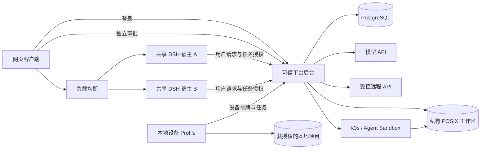

# PowerEvolve

[English](README.md) | 中文

PowerEvolve 的产品实现与上游 DSH 分开组织，共用一个仓库。开发入口是[架构决策](ARCHITECTURE.md)和[纵切面计划](DELIVERY-PLAN.md)。[当前 Cloud 试用](TRIAL-CLOUD-EXECUTION-RESOLUTION.md)记录原生 Web 执行对账及其限制；[S6 连接器](TRIAL-S6-FINAL-QA.md)仍是独立固定试用。更早的切片证据从交付计划查阅。[产品完整性审计](PARITY-AUDIT.md)跟踪尚未迁入的旧云端功能；[S7 集成说明](TRIAL-S7-INTEGRATED.md)跟踪发布检查。

| 目录 | 职责 |
| --- | --- |
| `application/src/host` | 用户 RPC、事件订阅、任务调度、原生 Session 持久化适配、模型适配 |
| `application/src/platform` | 身份、资源归属、PG 事务、任务租约、事件存储、带凭据的调用与沙盒管理 |
| `application/src/device`、`device` | 仅在本机开放的设备界面、目录授权、持久命令日志与受限 Docker 执行 |
| `application/web` | 临时切片测试界面与独立的可信审批页面 |
| `cloud-web`、`client-*` | 原生 DSH Web 外壳及品牌、工作区文件和执行位置选择等产品客户端插件，由 `/native/` 提供 |
| `sandbox`、`k8s` | 沙盒内命令执行器与仅限指定命名空间的平台权限 |
| `host`、`platform` | 两个独立 DSH Profile 的插件清单与部署参数 |
| `application/tests` | 真实 PG 与实际 Profile 的回归测试 |
| `scripts` | 本机配置和进程管理 |

产品包均为私有包。根构建包含产品 Host 和原生 Web 产物。`pnpm run test:power-evolve` 运行产品集成测试；`pnpm run test:power-evolve:web` 检查构建后的原生页面和 Host 静态路由。产品插件只使用当前基线的公开服务，不修改 Agent loop 或原生 Session 格式。登录、对话、云工作区、文件、产物、账号设置、个人文本和可执行技能，以及受控连接器已有原生 Web 试用证据。交付计划列出其余云端功能和部署检查；桌面实施按[官方桌面复用约定](DESKTOP-COMPLETION.md)推进。

会话回放资料保存在 [PowerEvolve snapshot](../../../snapshots/power-evolve/conversation/snapshot.yml)。产品测试使用其中的用户输入和助手回复，并逐事件比较完整 Session。该 Profile 需要真实 PG，使用产品测试命令运行；原生 `test:snapshot` 的四种 Profile 适配器不负责它。
