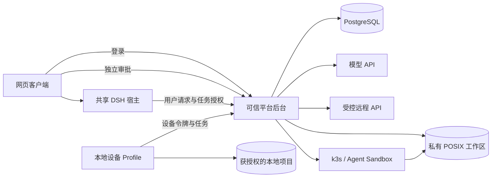

# PowerEvolve

[English](README.md) | 中文

PowerEvolve 的产品实现与上游 DSH 分开组织，共用一个仓库。开发入口是 [架构决策](ARCHITECTURE.md)，当前试用入口见 [切片 5 试用指南](TRIAL-SLICE5.md)；[切片 4](TRIAL-SLICE4.md)、[切片 3](TRIAL-SLICE3.md)、[切片 2](TRIAL-SLICE2.md)和[切片 1](TRIAL.md)试用仍独立保留。

| 目录 | 职责 |
| --- | --- |
| `application/src/host` | 用户 RPC、事件订阅、任务调度、原生 Session 持久化适配、模型适配 |
| `application/src/platform` | 身份、资源归属、PG 事务、任务租约、事件存储、带凭据的调用与沙盒管理 |
| `application/src/device`、`device` | 仅在本机开放的设备界面、目录授权、持久命令日志与受限 Docker 执行 |
| `application/web` | 对话、文件、技能、执行目标选择与独立的可信审批页面 |
| `sandbox`、`k8s` | 沙盒内命令执行器与仅限指定命名空间的平台权限 |
| `host`、`platform` | 两个独立 DSH Profile 的插件清单与部署参数 |
| `application/tests` | 真实 PG 与实际 Profile 的回归测试 |
| `scripts` | 本机配置和进程管理 |

产品包均为私有包。根构建的 Host TypeScript 项目包含产品代码，`pnpm run test:power-evolve` 运行产品集成测试；上游默认测试命令继续负责原生包。产品插件只使用当前基线的公开服务，不修改 Agent loop 或原生 Session 格式。

会话回放资料保存在 [PowerEvolve snapshot](../../../snapshots/power-evolve/conversation/snapshot.yml)。产品测试使用其中的用户输入和助手回复，并逐事件比较完整 Session。该 Profile 需要真实 PG，使用产品测试命令运行；原生 `test:snapshot` 的四种 Profile 适配器不负责它。
